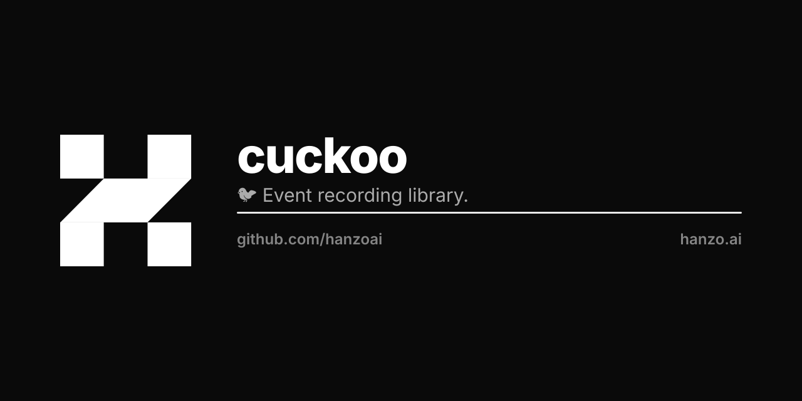

# cuckoo

  

> An event reporting library for [track.js](https://github.com/hanzo-io/track.js).

[![npm][npm-img]][npm-url]
[![build][build-img]][build-url]
[![dependencies][dependencies-img]][dependencies-url]
[![downloads][downloads-img]][downloads-url]
[![license][license-img]][license-url]
[![chat][chat-img]][chat-url]

## License
[BSD][license-url]

[examples]:         https://github.com/hanzo-io/cuckoo/blob/master/test/test.coffee

[build-img]:        https://img.shields.io/travis/hanzo-io/cuckoo.svg
[build-url]:        https://travis-ci.org/hanzo-io/cuckoo
[chat-img]:         https://badges.gitter.im/join-chat.svg
[chat-url]:         https://gitter.im/hanzo-io/chat
[coverage-img]:     https://coveralls.io/repos/hanzo-io/cuckoo/badge.svg?branch=master&service=github
[coverage-url]:     https://coveralls.io/github/hanzo-io/cuckoo?branch=master
[dependencies-img]: https://david-dm.org/hanzo-io/cuckoo.svg
[dependencies-url]: https://david-dm.org/hanzo-io/cuckoo
[downloads-img]:    https://img.shields.io/npm/dm/cuckoo.svg
[downloads-url]:    http://badge.fury.io/js/cuckoo
[license-img]:      https://img.shields.io/npm/l/cuckoo.svg
[license-url]:      https://github.com/hanzo-io/cuckoo/blob/master/LICENSE
[npm-img]:          https://img.shields.io/npm/v/cuckoo.svg
[npm-url]:          https://www.npmjs.com/package/cuckoo
